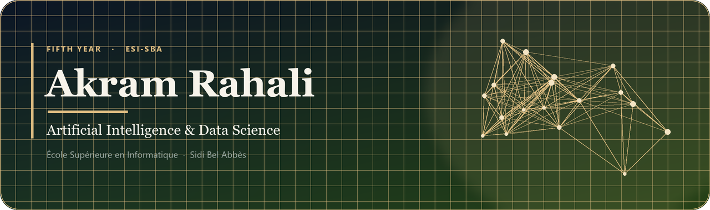
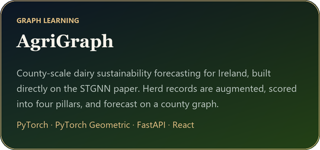
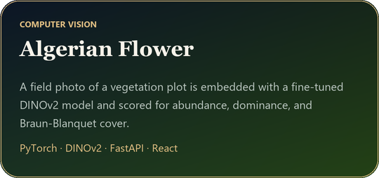
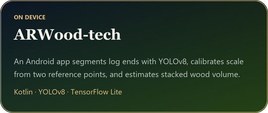
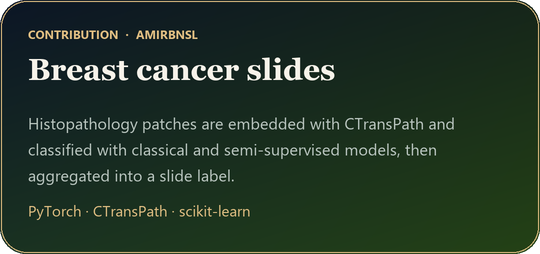
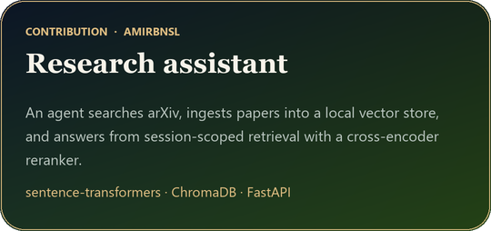
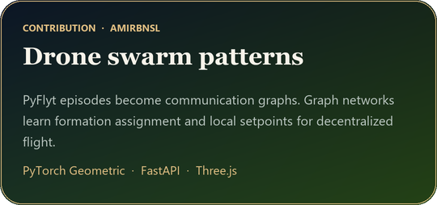

<em>Data science and AI come first. The applications are how that work gets used.</em>

<h2>Internship</h2>

<h2>Projects</h2>

<table>
<tr>
<td width="50%" valign="top" align="center">

</td>
<td width="50%" valign="top" align="center">

</td>
</tr>
<tr>
<td colspan="2" align="center">

</td>
</tr>
</table>

AgriGraph follows <a href="https://arxiv.org/abs/2512.19970">Spatio-Temporal Graph Neural Networks for Dairy Farm Sustainability Forecasting and Counterfactual Policy Analysis</a>.

<h2>Contributions</h2>

With <a href="https://github.com/AmirBnsL">AmirBnsL</a>.

<table>
<tr>
<td width="50%" valign="top" align="center">

</td>
<td width="50%" valign="top" align="center">

</td>
</tr>
<tr>
<td colspan="2" align="center">

</td>
</tr>
</table>

<a href="https://github.com/AmirBnsL/breast-cancer-unsupervised-app">Breast cancer slides</a>
&nbsp;·&nbsp;
<a href="https://github.com/AmirBnsL/research_assistant_app">Research assistant</a>
&nbsp;·&nbsp;
<a href="https://github.com/AmirBnsL/pattern-emergence-drone-swarms-gnn">Drone swarm patterns</a>

<h2>Technologies</h2>

<h3>Practical</h3>

 

 

<h3>Academic</h3>

 

 

 

 

 

