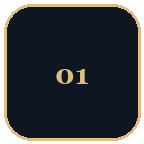
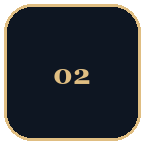
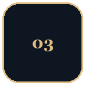
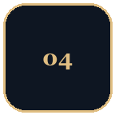
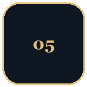

  

  <em>Applied machine learning, carried through to a product: forecasting, computer vision, graph models, and the services around them.</em>

  
  
  
  

## Internship

<table>
<tr>
<td width="33%" valign="top">
<b>Algérie Télécom</b> 
DOT Khenchela 
Telecom billing
</td>
<td width="34%" valign="top">
<b>Local client–server</b> 
Node.js · Express · EJS 
MongoDB
</td>
<td width="33%" valign="top">
<b>Four roles</b> 
Admin · service · corporate · client 
Access control on every workflow
</td>
</tr>
</table>

I designed and implemented a full-stack billing platform for residential and enterprise subscribers. The database is split across `comptes`, `compte_corporate`, `corporate_facture`, `conso_client`, and `cycle-facture`. It calculates bimonthly consumption and subscription fees, tracks payments and debt as they happen, and generates dynamic PDF invoices.

  
  
  
  

## Projects

Private repositories. A short note on each one is below.

<table>
<tr>
<td width="88" valign="top">

</td>
<td valign="top">
<b>AgriGraph</b> 
County-scale dairy sustainability · Ireland
  
A direct platform on the paper <a href="https://arxiv.org/abs/2512.19970">Spatio-Temporal Graph Neural Networks for Dairy Farm Sustainability Forecasting and Counterfactual Policy Analysis</a>. ICBF herd records are augmented with a variational autoencoder, scored into four operational pillars, and forecast with a spatio-temporal graph neural network, with a map for benchmarks and counterfactual policy levers.
  

</td>
</tr>
</table>

 

<table>
<tr>
<td width="88" valign="top">

</td>
<td valign="top">
<b>Algerian Flower</b> 
Botanical field relevés
  
A photo of a vegetation plot is embedded with a fine-tuned DINOv2 vision transformer and scored for species abundance, dominance, and Braun-Blanquet cover.
  

</td>
</tr>
</table>

 

<table>
<tr>
<td width="88" valign="top">

</td>
<td valign="top">
<b>ARWood-tech</b> 
On-device stacked timber estimation
  
An Android app segments log ends in a photo with YOLOv8, calibrates scale from two reference points, and computes wood volume.
  

</td>
</tr>
</table>

 

<table>
<tr>
<td width="88" valign="top">

</td>
<td valign="top">
<b>BoviTrack</b> 
Livestock operations · Algeria
  
Farmers, veterinarians, and zootechnicians share one mobile app for herd records, vet visits, feed rations with nutritional totals, and professional contracts.
  

</td>
</tr>
</table>

 

<table>
<tr>
<td width="88" valign="top">

</td>
<td valign="top">
<b>Breast cancer histopathology</b> 
Slide-level tissue classification
  
A Gradio app classifies histopathology patches with CTransPath embeddings and classical and semi-supervised models, then aggregates the votes into a slide label.
  

</td>
</tr>
</table>

 

  <b>Want to see more details about the private repos? Click on <a href="https://rahaliakram.me">rahaliakram.me</a></b>
    
  

## Technologies

### Practical
What the projects and the internship actually run on.

  
  
  
  
  
    
  
  
  
  
  
    
  
  
  

Graph learning with PyTorch Geometric, classical ML and gradient boosting, and vision backbones (DINOv2, YOLO, CTransPath), plus the APIs and interfaces in front of them.

### Academic
Coursework at ESI-SBA, beyond these repositories.

  
  
  
  
  
    
  
  
  
  
  

| Area | What I studied |
| --- | --- |
| Machine learning & deep learning | Supervised and unsupervised learning, neural networks, training and evaluation in Python and PyTorch |
| Natural language processing | Text representation, language models, and NLP pipelines |
| Large-scale data processing | Apache Spark — MLlib, Spark SQL, and GraphX |
| High-performance computing | Parallel numerical computation in C |
| Databases | Relational SQL (PostgreSQL, Oracle Database) and NoSQL (MongoDB, Cassandra, Neo4j) |
| Numerical analysis | Numerical methods and statistical computing in R |
